<picture>
  <source media="(prefers-color-scheme: dark)" srcset="./dark.svg">
  <source media="(prefers-color-scheme: light)" srcset="./light.svg">
  
</picture>

### Hi, I'm Mateen Akram

AI Engineer and Full-Stack Software Developer building AI-powered web applications, voice AI platforms, automation pipelines and real-time communication systems.

## About

- Associate Software Engineer at **RipeSeed**, working on Credible Ai, an AI-agent platform for marketing content.
- Build scalable web apps and REST APIs with **Python, FastAPI, Next.js, React and Node.js**.
- Work with **LLM integrations**, AI agents, chatbots, voice AI and deep learning models.
- Automate business workflows with **n8n, Docker and the OpenAI API**.
- Care about backend architecture, API design, database management and Agile delivery.
- **Focus:** LLM Apps · Voice AI · AI Automation · REST APIs

## Experience

### Associate Software Engineer · RipeSeed
Sept 2026 – Present · Lahore, Pakistan

- Developed **Credible Ai**, an AI-powered marketing content generation platform using Next.js and an AI agent to create high-quality social media posts based on real market signals.

### Software Engineer · BitPix Soft
July 2025 – Sept 2026 · Lahore, Pakistan

- Developed **Talkbase**, an AI-powered voice calling platform using Next.js, FastAPI, Twilio and LiveKit for low-latency local and international AI communication.
- Designed, developed and integrated scalable RESTful APIs following Agile methodologies.
- Worked on backend architecture, real-time communication systems, API optimization and AI workflow integration.

### AI & Automation Engineer · Robx.AI
April 2025 – June 2025 · Remote

- Built an AI-powered customer support chatbot using OpenAI APIs, n8n, Docker, SMTP automation and workflow orchestration tools.
- Implemented Facebook Marketplace automation pipelines and intelligent process automation workflows.
- Optimized automation processes and integrated AI conversational systems for customer engagement.

## Featured Projects

| Project | What it does | Built with |
| --- | --- | --- |
| **Talkbase** | AI-powered voice communication platform for creating AI callers that handle local and international calls with minimal latency using LLMs, with Google Workspace integration for call data, reporting and email notifications. | `Next.js` `Tailwind CSS` `FastAPI` `Twilio` `LiveKit` |
| **MobiCrash** | AI-based traffic monitoring system that uses Safe City camera feeds to detect mobile phone usage while driving and automatically generate challans and authority alerts. | `Python` `Next.js` `FastAPI` `Twilio` |
| **Credible Ai** | AI-powered marketing content generation platform that uses an AI agent to produce social media posts based on real market signals (built at RipeSeed). | `Next.js` `AI Agents` |
| **StayVerse** | Airbnb-style hotel booking and management platform with AI-based recommendations, analytics dashboards, authentication, calendar scheduling and Google Workspace integrations. | `React.js` `Node.js` `Express.js` `MongoDB` |
| **Transcribe** | AI-powered desktop application for meeting transcription, minutes generation and speech processing. | `React.js` `Rust` `Python` |
| **CuraSense** | AI healthcare assistant with image and voice-based disease prediction, precaution recommendations and text/audio responses. | `Python` `Gradio` `Grok API` |
| **ChatBot Generator** | Customizable system that builds domain-specific conversational assistants from user-provided data. | `Python` `React.js` `Tailwind CSS` |
| **Next Word Prediction** | Deep learning next-word prediction model using LSTM networks for sequence generation and NLP. | `Python` `LSTM RNN` |
| **CasaConnect** | Real estate Android app with property listings, bookings, authentication, search and Firebase realtime database. | `Kotlin` `Firebase` |
| [**Professional Resume Website**](https://mateen-portfolio.vercel.app) | Responsive portfolio and resume website built with modern UI/UX principles. | `React.js` `Tailwind CSS` |

<b>More projects</b>

- Social Media Platform (C++ OOP)
- E-commerce Application (Kotlin)
- Leave Management System (C++)
- Sudoku Solver using Backtracking (C++)
- Ticketing System (Python OOP/DSA)
- Flappy Bird Clone (x8086 Assembly)
- Josephus Problem Visualizer (C++ with SFML)

## Engineering Stack

| Area | Tools |
| --- | --- |
| Languages | `Python` · `C` · `C++` · `C#` · `JavaScript` · `Kotlin` · `PHP` · `x8086 Assembly` |
| Frontend | `HTML5` · `CSS3` · `React.js` · `Next.js` · `Tailwind CSS` |
| Backend | `FastAPI` · `Flask` · `Express.js` · `Node.js` · `REST APIs` |
| AI / ML | `TensorFlow` · `Keras` · `LSTM RNN` · `OpenAI APIs` · `LLM Integration` · `NLP` |
| Databases | `MongoDB` · `MySQL` · `PostgreSQL` · `SQL Server` · `Firebase` |
| DevOps & Tools | `Git` · `Docker` · `Selenium` · `Jira` · `Figma` · `Twilio` · `LiveKit` · `n8n` · `Google Workspace` |
| Mobile & Games | `Android Studio` · `React Native` · `Unity` · `Photon PUN 2` |

## Education

- **FAST – National University of Computer and Emerging Sciences**, Lahore — BS Computer Science

## GitHub Activity

<picture>
  <source media="(prefers-color-scheme: dark)" srcset="https://github-readme-stats.vercel.app/api?username=MateenAkram1&show_icons=true&hide_border=true&bg_color=0B1220&title_color=22D3EE&icon_color=7C3AED&text_color=CBD5E1">
  
</picture>

## Connect

[GitHub](https://github.com/MateenAkram1) · [LinkedIn](https://linkedin.com/in/mateen-akram-b663b0298) · [Portfolio](https://mateen-portfolio.vercel.app) · [Email](mailto:mateen.akram124@gmail.com)
